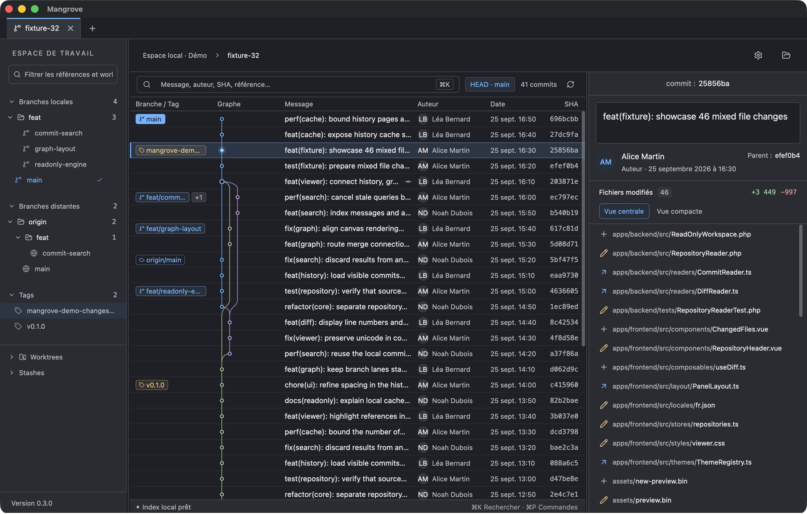
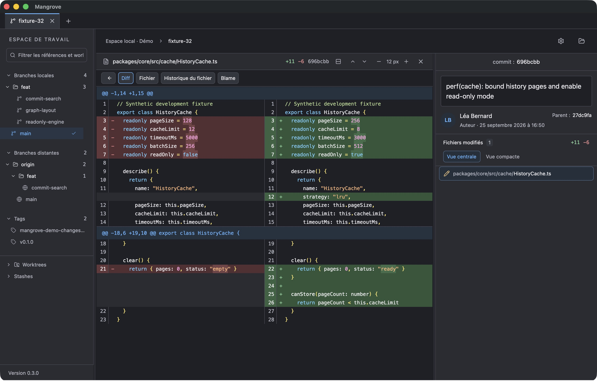

# Mangrove

Client Git desktop natif pour explorer l’historique, les branches et les diffs d’un dépôt. Il ne modifie ni les fichiers ni l’index : seul le fetch met à jour les références distantes. L’interface native est dessinée avec GPUI au-dessus du moteur Rust `mangrove-core`, sans WebView ni serveur local.

## Aperçu

Captures de Mangrove sur macOS, avec un dépôt de démonstration et des données fictives.

**Fenêtre principale** — branches, graphe de l’historique et détails du commit.



**Diff côte à côte** — coloration syntaxique, ajouts, suppressions et mots modifiés surlignés.



## Fonctionnalités

- **Dépôts** : dépôts locaux, bare et worktrees ; récents et favoris par profil ; onglets qui retrouvent leur sélection, leur recherche et leur position de lecture.
- **Historique** : graphe des branches et des merges, colonne des références, recherche par message, auteur, SHA ou référence.
- **Branches** : branches locales et distantes, tags, dossiers repliables, filtre et mode **Solo** ; avance et retard sur l’upstream ; worktrees et stashes ([détails](docs/repository-context.md)).
- **Commits** : détails, fichiers modifiés, diffs unifiés ou côte à côte avec coloration syntaxique et mots modifiés surlignés, aperçus d’images avant/après.
- **Fichiers** : contenu à une révision, historique qui suit les renommages, blame ([détails](docs/file-browser.md)).
- **Modifications locales** : fichiers indexés, non indexés et non suivis, en lecture seule.
- **Fetch** : manuel ou automatique, avec des erreurs résumées et le détail de Git.
- **Mises à jour** : recherche au lancement puis toutes les six heures, installation des releases signées en arrière-plan et redémarrage en un clic, réglables dans les paramètres ([détails](docs/releases.md#mises-à-jour-intégrées)).
- **Intégrations** : profils, comptes GitLab, GitHub et Bitbucket (dépôts, PR/MR, CI), clonage HTTPS ou SSH ; jetons dans le coffre de l’OS ([détails](docs/integrations.md)).
- **Interface** : sept thèmes dont [Catppuccin](https://catppuccin.com/palette/) Macchiato, palette de commandes **Cmd/Ctrl + P** ([commandes](docs/command-palette.md)), navigation au clavier, panneaux redimensionnables et zoom.

## Installer

Les builds macOS (Apple Silicon et Intel), Linux et Windows sont attachés aux [releases GitHub](https://github.com/Dpblandin/mangrove/releases) ; voir [l’installation](docs/releases.md#installer-une-release). Le fetch et le clonage utilisent Git installé sur la machine.

La QA interactive est faite sur macOS Apple Silicon. Les builds Linux et Windows sont compilés et testés par la CI, mais pas encore validés à l’écran.

## Compiler

Prérequis : Rust via rustup (la version est fixée par `rust-toolchain.toml`) et les [prérequis GPUI Kit](https://gpui-kit.com/docs/installation/) de l’OS, dont Xcode complet sur macOS.

```sh
cargo run --release --locked --manifest-path src-gpui/Cargo.toml
cargo run --release --locked --manifest-path src-gpui/Cargo.toml -- /chemin/du/depot

# Bundle macOS : src-gpui/target/release/bundle/Mangrove.app
sh src-gpui/scripts/package-macos.sh
```

## Développer

La CI lance ces vérifications sur macOS, Linux et Windows :

```sh
cargo fmt --all --check
cargo clippy --locked -p mangrove-core -p mangrove-remote -p mangrove-update --all-targets -- -D warnings
cargo test --locked -p mangrove-core -p mangrove-remote -p mangrove-update

cargo fmt --manifest-path src-gpui/Cargo.toml --all --check
cargo clippy --locked --manifest-path src-gpui/Cargo.toml --all-targets -- -D warnings
cargo test --locked --manifest-path src-gpui/Cargo.toml
```

Pour créer un dépôt synthétique dans `.mangrove-dev/` (Node.js et Git suffisent) :

```sh
node scripts/create-fixture.mjs --commits 10000 --large-change
```

Une version se publie avec `scripts/release.sh X.Y.Z` ; voir [les releases](docs/releases.md).

## Organisation

- `crates/mangrove-core` : lecture Git, graphe, index de recherche et cache.
- `crates/mangrove-remote` : profils, coffre de l’OS, API des hébergeurs et SSH.
- `crates/mangrove-update` : releases GitHub, signatures minisign et installation des mises à jour.
- `src-gpui` : application GPUI, dans un workspace Cargo séparé ([README](src-gpui/README.md)).
- `scripts` : fixtures, benchmarks et release.
- `docs` : [architecture](docs/architecture.md), [performances](docs/performance.md) et documentation des fonctionnalités.

## Licence

Mangrove est distribué sous [Functional Source License 1.1, avec MIT comme licence future](LICENSE.md) (FSL-1.1-MIT). L’utiliser, y compris au travail, le modifier et le redistribuer est permis ; l’intégrer à un produit ou service commercial concurrent ne l’est pas. Chaque version passe sous licence MIT deux ans après sa publication. Les licences des composants tiers accompagnent chaque build publié.
